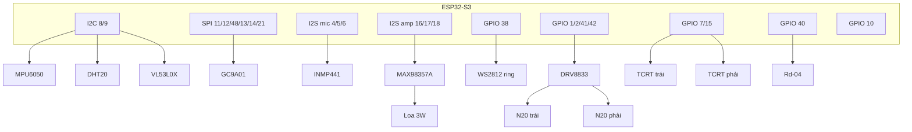

# Hướng dẫn đấu dây RoboDesk (cho người mới)

Tài liệu này giả định bạn **chưa từng làm mạch điện**. Làm **đúng thứ tự**, **đo bằng đồng hồ** trước khi bật nguồn.

**Đọc kèm:** `BOM.txt` (linh kiện), `docs/PINMAP.md` (chân GPIO), `docs/POWER.md` (nguồn).

---

## 0. Bạn cần biết gì trước khi bắt đầu?

### Thuật ngữ cơ bản

| Từ | Nghĩa |
|---|---|
| **VCC / 3V3 / 5V** | Dây nguồn dương |
| **GND** | Dây mass (âm) — mọi module phải chung GND |
| **GPIO** | Chân tín hiệu trên ESP32 (đánh số 1, 2, 4, 5…) |
| **I2C** | Bus 2 dây (SDA + SCL) — nhiều cảm biến dùng chung |
| **SPI** | Bus màn hình (nhiều dây, nhanh) |
| **I2S** | Bus âm thanh (mic + loa) |
| **PWM** | Tín hiệu điều khiển motor / độ sáng |

### Dụng cụ cần có

- Đồng hồ vạn năng (bắt buộc)
- Mỏ hàn, thiếc, giắt hàn (hoặc dây Dupont chất lượng tốt nếu test tạm)
- Dây điện nhiều màu: **đỏ** = nguồn, **đen** = GND, màu khác = tín hiệu
- Tua vít nhỏ, kìm tuốt dây
- Keo nóng / zip tie cố định dây

### An toàn (đọc kỹ)

1. Pin 18650 **cháy nổ** nếu ngắn mạch — luôn có **công tắc gạt** trên đường PACK+.
2. Mạch sạc **không bảo vệ xả** → tắt robot khi pin yếu, không để qua đêm.
3. **Không** nối 5V vào chân 3.3V của cảm biến.
4. Lắp xong mỗi khối → đo lại trước khi sang khối tiếp theo.
5. Test motor: **tháo bánh xe** hoặc nhấc robot khỏi mặt bàn.

---

## 1. Sơ đồ tổng thể robot

### Nhìn từ trên (bố trí cơ khí)

```
                 ┌─────────────────┐
                 │ GC9A01 + WS2812 │  ← mặt robot
                 └────────┬────────┘
                          │
                 ┌────────┴────────┐
                 │   ESP32-S3      │
                 └────────┬────────┘
        VL53L0X (trước)          Rd-04 (trước, hướng lên)
    ┌─────────── khung ───────────┐
    │ [Motor L]           [Motor R] │
    │    ○ bánh N20        ○ bánh N20 │
    └───────────┬───────────┘
           TCRT-L   TCRT-R  (gắn đáy, hướng xuống)
                 ◆ omni (sau)
           DHT20 (cạnh)   MPU6050 (giữa)
              [Pin 2S + sạc + buck]
```

### Sơ đồ kết nối tín hiệu (mermaid)



---

## 2. Đấu nguồn (làm trước tiên)

Xem chi tiết `docs/POWER.md`. Tóm tắt từng dây:

| Từ | Đến | Màu gợi ý |
|---|---|---|
| Pin 1 (+) nối tiếp pin 2 | Đế pin 2S → PACK+ | Đỏ |
| Pin 1 (−) nối pin 2 (+) | (trong đế) | — |
| PACK− | GND chung toàn robot | Đen dày |
| PACK+ | Công tắc gạt (chân IN) | Đỏ |
| Công tắc (chân OUT) | MP1584 VIN+ | Đỏ |
| PACK− / GND đế | MP1584 VIN− / GND | Đen |
| MP1584 OUT+ | Bus 5V | Đỏ |
| MP1584 OUT− | GND chung | Đen |
| Bus 5V | ESP32 **VIN** (hoặc 5V) | Đỏ |
| GND chung | ESP32 **GND** | Đen |

**Kiểm tra:** Công tắc ON, chưa cắm module → đo OUT buck = **5.00V**.

### Chia áp đo pin (khuyến nghị)

| Từ | Đến |
|---|---|
| PACK+ (sau công tắc) | Đầu 100kΩ |
| Giữa 100kΩ và 33kΩ | GPIO **10** |
| Cuối 33kΩ | GND |

---

## 3. Đấu từng khối — bảng chi tiết

### 3.1 Bus I2C (MPU6050 + DHT20 + VL53L0X)

**Cùng 4 dây cho cả 3 module** (mắc song song):

| Chân module | Nối tới | Ghi chú |
|---|---|---|
| VCC | 3.3V (ESP pin 3V3) | Đỏ |
| GND | GND chung | Đen |
| SDA | GPIO **8** | Xanh lá |
| SCL | GPIO **9** | Vàng |

| Module | Địa chỉ I2C | Gắn ở đâu trên robot |
|---|---|---|
| MPU6050 | 0x68 | Giữa khung (đo nghiêng) |
| DHT20 | 0x38 | Cạnh hông (thoát nhiệt) |
| VL53L0X | 0x29 | Mũi robot (nhìn phía trước) |

> Một số module in sẵn **SDA/SCL** hoặc **SDO/SCK** — SDA=SDO, SCL=SCK.

### 3.2 Màn hình GC9A01 (SPI)

| Chân GC9A01 | ESP32 GPIO | Màu gợi ý |
|---|---:|---|
| VCC | 3.3V | Đỏ |
| GND | GND | Đen |
| SCL / SCK | **12** | Vàng |
| SDA / MOSI | **11** | Xanh lá |
| CS | **48** | Cam |
| DC | **13** | Tím |
| RST | **14** | Trắng |
| BL (backlight) | **21** | Xám |

### 3.3 Micro INMP441 (I2S)

| Chân INMP441 | ESP32 | Ghi chú |
|---|---|---|
| VDD | 3.3V | |
| GND | GND | |
| SCK / BCLK | GPIO **5** | |
| WS / LRCLK | GPIO **4** | |
| SD (data) | GPIO **6** | |
| L/R | GND | Chế độ mono trái |

### 3.4 Amply MAX98357A + loa (I2S)

| Chân MAX98357A | ESP32 / nguồn | Ghi chú |
|---|---|---|
| Vin | **5V** bus | Không 3.3V |
| GND | GND | |
| BCLK | GPIO **17** | |
| LRC | GPIO **18** | |
| DIN | GPIO **16** | |
| GAIN | GND | ~9 dB (hoặc để trống theo datasheet) |
| SD | 3.3V hoặc float | Bật amp |
| + / − | Loa 3W | Đúng cực |

### 3.5 Vòng LED WS2812

| Chân | Nối tới | Ghi chú |
|---|---|---|
| VCC | **5V** | Thêm tụ 470µF gần vòng LED |
| GND | GND chung | |
| DIN | GPIO **38** qua **level shifter** 3.3→5V | Thử trực tiếp 3.3V chỉ khi test độ sáng thấp |

### 3.6 Motor DRV8833 + N20 (300 RPM)

| Chân DRV8833 | Nối tới |
|---|---|
| VM | 5V (+ tụ 100µF) |
| VCC | 3.3V |
| GND | GND |
| AIN1 | GPIO **1** |
| AIN2 | GPIO **2** |
| BIN1 | GPIO **41** |
| BIN2 | GPIO **42** |
| AOUT1, AOUT2 | Motor **trái** |
| BOUT1, BOUT2 | Motor **phải** |

Motor có 2 dây — đảo 2 dây = đảo chiều quay (không hỏng).

### 3.7 Cảm biến an toàn & presence

| Cảm biến | Chân | ESP32 | Cách hoạt động |
|---|---|---:|---|
| TCRT5000 trái | DO | **15** | DO = 0 khi phát hiện mép/vật gần (tuỳ chỉnh pot trên module) |
| TCRT5000 phải | DO | **7** | Giống trái |
| Rd-04 | OUT | **40** | HIGH = có người (module pull-up) |

**Chỉnh TCRT5000:** Xoay potentiometer trên module — đưa sensor sát mặt bàn trắng vs mép bàn, chỉnh đến khi đèn LED module đổi trạng thái rõ ràng.

### 3.8 Rd-04 radar

Hầu hết module Rd-04 có 3–4 chân:

| Chân thường gặp | Nối |
|---|---|
| VCC | 5V (nếu module 5V) hoặc 3.3V — **đọc silk trên board** |
| GND | GND |
| OUT | GPIO **40** |

---

## 4. Thứ tự lắp ráp (quan trọng)

Làm **từng bước**, bật nguồn test trước khi sang bước sau.

```
Bước 1  Pin 2S + sạc + công tắc + buck → đo 5.00V
   ↓
Bước 2  Cắm ESP32 (VIN + GND) → flash firmware → Serial boot OK
   ↓
Bước 3  GC9A01 → thấy mặt / backlight
   ↓
Bước 4  I2C: MPU6050 → DHT20 → VL53L0X (scan 0x68, 0x38, 0x29)
   ↓
Bước 5  WS2812 (độ sáng thấp)
   ↓
Bước 6  INMP441 + MAX98357A → tiếng beep
   ↓
Bước 7  DRV8833 + 1 motor (bánh tháo) → quay duty thấp
   ↓
Bước 8  TCRT + Rd-04 → test tay trên Serial / màn status
   ↓
Bước 9  Gắn bánh, omni, khung — test trên bàn rộng, có tay giữ
```

---

## 5. Sơ đồ nối dây nguồn chi tiết (ASCII)

```
                    ┌──────────────┐
    USB ───────────►│ Mạch sạc 2S  │
                    │  (BM1)       │
                    └──────┬───────┘
                           │
              ┌────────────┴────────────┐
              │   [Pin1]═══[Pin2]       │  ← đế 2S, nối tiếp
              │    PACK+    PACK-       │
              └─────┬──────────┬────────┘
                    │          │
             ┌──────┴───┐      │
             │ Công tắc │      │
             └──────┬───┘      │
                    │          ├────────────────── GND chung (đen)
             ┌──────┴───┐      │                        │
             │ MP1584EN │      │                        │
             │  5.0V OUT├──────┼──► ESP VIN             │
             └──────────┘      │    WS2812 VCC          │
                    │          │    DRV8833 VM          │
             [100k]──┬──[33k]  │    MAX98357 Vin        │
                    │          │                        │
                 GPIO10        │                   ESP GND
                               │
                          ESP 3V3 ──► tất cả VCC 3.3V
                                      (I2C, LCD, mic, DRV VCC)
```

---

## 6. Xử lý sự cố thường gặp

| Triệu chứng | Nguyên nhân hay gặp | Cách sửa |
|---|---|---|
| ESP không boot | 5V sai / GND không chung | Đo lại buck, nối GND tất cả module |
| I2C scan trống | SDA/SCL đảo / thiếu 3.3V | Kiểm tra GPIO 8, 9 và nguồn module |
| LCD trắng / đen | Sai SPI hoặc chưa RST | Kiểm tra CS=48, RST=14, BL=21 |
| WS2812 không sáng | Thiếu level shift / sai 5V | Thêm level shifter, kiểm tra DIN=38 |
| Motor không quay | VM chưa 5V / GND DRV | Đo VM, VCC logic 3.3V |
| ESP reset khi motor chạy | Sụt áp 5V | Thêm tụ 1000µF, giảm duty motor |
| TCRT không đổi | Pot chưa chỉnh / sai DO | Xoay pot, đo DO bằng đồng hồ |
| Pin % sai | Chưa có chia áp | Lắp 100k/33k vào GPIO10 |

---

## 7. Sau khi đấu xong

1. Điền checklist: `docs/BRINGUP_CHECKLIST.md`
2. Flash firmware: xem `README.md` mục Firmware
3. (Tuỳ chọn) Kết nối Pi 5 Linked mode: `docs/PROTOCOL.md`

**Chân GPIO đầy đủ:** `docs/PINMAP.md`
