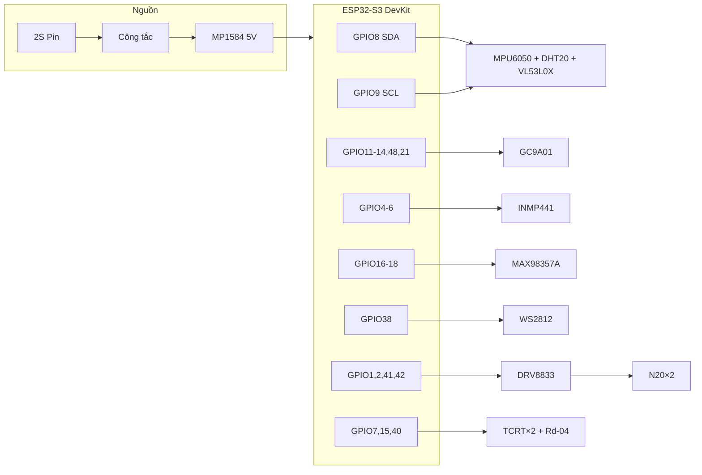

# Bảng nối dây chi tiết — chân module ↔ ESP32-S3

Tài liệu này trả lời câu hỏi: **nhãn in trên từng mạch cắm vào đâu trên ESP32?**

Firmware dùng đúng các GPIO trong `firmware/esp32/main/board_pins.h`.

**Đọc kèm:** `docs/WIRING.md` (thứ tự lắp), `docs/POWER.md` (nguồn).

---

## 1. ESP32-S3 DevKitC-1 N16R8 — vị trí chân trên board

Hướng board: **cổng USB Type-C hướng xuống**, nhìn từ trên xuống. Hai hàng header trái/phải.

### Header J1 (bên trái, từ trên xuống)

| Số lỗ | Nhãn trên board | Dùng cho RoboDesk |
|---:|---|---|
| 1 | 3V3 | **Nguồn 3.3V** → cảm biến, LCD, mic, DRV VCC |
| 2 | 3V3 | (dự phòng) |
| 3 | RST | Không nối (nút reset có sẵn) |
| 4 | **GPIO4** | → INMP441 **WS** |
| 5 | **GPIO5** | → INMP441 **SCK** |
| 6 | **GPIO6** | → INMP441 **SD** |
| 7 | **GPIO7** | → TCRT5000 **phải** DO |
| 8 | **GPIO15** | → TCRT5000 **trái** DO |
| 9 | **GPIO16** | → MAX98357A **DIN** |
| 10 | **GPIO17** | → MAX98357A **BCLK** |
| 11 | **GPIO18** | → MAX98357A **LRC** |
| 12 | **GPIO8** | → I2C **SDA** (bus chung) |
| 13 | GPIO19 | Không dùng |
| 14 | GPIO20 | Không dùng |
| 15 | GPIO3 | **Không dùng** (strapping) |
| 16 | GPIO46 | **Không dùng** (strapping) |
| 17 | **GPIO9** | → I2C **SCL** (bus chung) |
| 18 | **GPIO10** | → Chia áp đo pin (ADC) |
| 19 | **GPIO11** | → GC9A01 **MOSI/SDA** |
| 20 | **GPIO12** | → GC9A01 **SCK/SCL** |
| 21 | **GPIO13** | → GC9A01 **DC** |
| 22 | **GPIO14** | → GC9A01 **RST** |
| 23 | 5V | Lấy 5V từ buck (hoặc dùng chân **VIN** ở dưới board) |
| 24 | GND | **GND chung** |
| 25 | GND | **GND chung** |

### Header J3 (bên phải, từ trên xuống)

| Số lỗ | Nhãn trên board | Dùng cho RoboDesk |
|---:|---|---|
| 1 | GPIO43 (TX) | Serial USB — không đấu dây |
| 2 | GPIO44 (RX) | Serial USB — không đấu dây |
| 3 | **GPIO1** | → DRV8833 **AIN1** (motor trái) |
| 4 | **GPIO2** | → DRV8833 **AIN2** (motor trái) |
| 5 | **GPIO42** | → DRV8833 **BIN2** (motor phải) |
| 6 | **GPIO41** | → DRV8833 **BIN1** (motor phải) |
| 7 | **GPIO40** | → Rd-04 **OUT** |
| 8 | GPIO39 | Rd-04 UART TX (chỉ nếu module dùng serial) |
| 9 | **GPIO38** | → WS2812 **DIN** (qua level shifter) |
| 10–12 | GPIO37–35 | Không dùng |
| 13 | GPIO0 | **Không dùng** (strapping) |
| 14 | GPIO45 | **Không dùng** (strapping) |
| 15 | **GPIO48** | → GC9A01 **CS** |
| 16 | GPIO47 | Nút user (tùy chọn, không có trong BOM) |
| 17 | **GPIO21** | → GC9A01 **BL** (backlight) |
| 18 | GND | **GND chung** |
| 19 | GND | **GND chung** |

### Nguồn ESP32

| Chân ESP32 | Nối từ đâu | Ghi chú |
|---|---|---|
| **VIN** (thường ở góc board) hoặc **5V** header | MP1584 **OUT+** (5.0V) | Cấp nguồn chính |
| **GND** (bất kỳ) | GND chung toàn robot | |
| **3V3** (header J1 pin 1–2) | Nguồn ra từ regulator onboard | Cấp cho module 3.3V |

> Có thể cấp ESP qua **USB** khi đang lập trình; khi chạy pin thì dùng **VIN/5V** từ buck.

---

## 2. Khối nguồn — từng cổng

### 2.1 Đế pin 2S + mạch sạc Type-C

| Nhãn trên mạch sạc / đế pin | Nối tới |
|---|---|
| B+ / BAT+ | Cực **+** của cụm 2 pin (nối tiếp) |
| B− / BAT− | Cực **−** của cụm 2 pin |
| P+ / OUT+ / C+ | → **PACK+** (đi tới công tắc) |
| P− / OUT− / C− | → **GND chung** |
| USB Type-C | Sạc pin (không cấp nguồn cho robot khi đang chạy motor) |

**Cách lắp 2 pin nối tiếp (2S):**
- Pin 1 **+** → đế (+)
- Pin 1 **−** → Pin 2 **+** (nối trong đế)
- Pin 2 **−** → đế (−)

### 2.2 Công tắc gạt

| Chân công tắc | Nối tới |
|---|---|
| 1 (giữa) | PACK+ từ mạch sạc |
| 2 (một đầu) | MP1584 **IN+** |
| Khi OFF | Ngắt hoàn toàn đường PACK+ → tải |

### 2.3 MP1584EN (buck 5V)

| Nhãn trên module MP1584 | Nối tới | Màu dây gợi ý |
|---|---|---|
| **IN+** / VIN+ | Sau công tắc (PACK+) | Đỏ |
| **IN−** / VIN− / GND | GND chung | Đen |
| **OUT+** / VOUT+ | Bus **5V** | Đỏ |
| **OUT−** / GND | GND chung | Đen |
| Potentiometer (vặn nhỏ trên board) | Chỉnh đến đo **5.00V** ở OUT (không tải) | — |

**Bus 5V cấp cho:** ESP VIN, WS2812 VCC, DRV8833 VM, MAX98357A Vin.

### 2.4 Chia áp đo pin → GPIO10

| Điểm nối | Chi tiết |
|---|---|
| PACK+ (sau công tắc) | → đầu điện trở **100kΩ** |
| Giữa 100kΩ và 33kΩ | → ESP **GPIO10** (J1 lỗ 18) |
| Cuối 33kΩ | → GND |

---

## 3. MPU6050 (module GY-521 / 6 trục)

| Nhãn trên module MPU6050 | Nối tới ESP32 / nguồn |
|---|---|
| **VCC** | **3V3** (J1 pin 1) |
| **GND** | **GND** |
| **SCL** | **GPIO9** (J1 lỗ 17) |
| **SDA** | **GPIO8** (J1 lỗ 12) |
| AD0 | Để trống hoặc nối **GND** → địa chỉ I2C **0x68** |
| XDA, XCL, INT | **Không nối** |

---

## 4. DHT20 (nhiệt độ / độ ẩm I2C)

| Nhãn trên module DHT20 | Nối tới |
|---|---|
| **VCC** / 3V3 | **3V3** ESP |
| **GND** | **GND** |
| **SDA** | **GPIO8** (cùng bus với MPU, VL53) |
| **SCL** | **GPIO9** |

Địa chỉ I2C: **0x38**.

---

## 5. VL53L0X (laser ToF)

| Nhãn trên module VL53L0X | Nối tới |
|---|---|
| **VCC** / 2V8 / 3V3 | **3V3** ESP |
| **GND** | **GND** |
| **SDA** | **GPIO8** |
| **SCL** | **GPIO9** |
| XSHUT | **3V3** (giữ sensor luôn bật) hoặc GPIO tùy ý |
| GPIO1 (INT) | **Không nối** (firmware polling) |

Địa chỉ I2C: **0x29**.

---

## 6. GC9A01 màn tròn 1.28" (8 chân)

Module thường in một trong các tên sau — **cùng một chân**:

| Nhãn trên màn GC9A01 | Tên khác hay gặp | Nối tới ESP32 |
|---|---|---|
| **VCC** | 3V3 | **3V3** |
| **GND** | GND | **GND** |
| **SCL** | SCK, CLK | **GPIO12** (J1 lỗ 20) |
| **SDA** | MOSI, DIN, DI | **GPIO11** (J1 lỗ 19) |
| **CS** | — | **GPIO48** (J3 lỗ 15) |
| **DC** | RS, D/C | **GPIO13** (J1 lỗ 21) |
| **RST** | RES, RESET | **GPIO14** (J1 lỗ 22) |
| **BL** | LED, BLK | **GPIO21** (J3 lỗ 17) |

> Một số board GC9A01 **không có chân BL** — nối LED backlight trực tiếp 3.3V qua điện trở 100Ω (luôn sáng).

---

## 7. INMP441 (micro I2S)

Nhìn **mặt có lỗ lấy âm** hướng ra ngoài. Breakout 6 chân:

| Nhãn trên INMP441 | Nối tới ESP32 / nguồn |
|---|---|
| **VDD** | **3V3** |
| **GND** | **GND** |
| **SCK** | **GPIO5** (J1 lỗ 5) — I2S BCLK |
| **WS** | **GPIO4** (J1 lỗ 4) — I2S LRCLK |
| **SD** | **GPIO6** (J1 lỗ 6) — data từ mic |
| **L/R** | **GND** (chọn kênh trái / mono) |

---

## 8. MAX98357A (amp I2S) + loa 3W

| Nhãn trên MAX98357A | Nối tới |
|---|---|
| **Vin** / VDD | Bus **5V** (MP1584 OUT+) |
| **GND** | **GND** |
| **BCLK** | **GPIO17** (J1 lỗ 10) |
| **LRC** / LRCLK / WS | **GPIO18** (J1 lỗ 11) |
| **DIN** / SD | **GPIO16** (J1 lỗ 9) |
| **GAIN** | **GND** (= 9 dB) hoặc để trống |
| **SD** / EN | **3V3** (bật amp) hoặc để trống nếu module tự pull-up |
| **+** / SPK+ / OUT+ | Cực **+** loa 3W |
| **−** / SPK− / OUT− | Cực **−** loa 3W |

---

## 9. WS2812 NeoPixel (vòng LED)

| Nhãn trên vòng LED | Nối tới |
|---|---|
| **VCC** / 5V / + | Bus **5V** (+ tụ 470µF sát vòng LED) |
| **GND** / GND | **GND** |
| **DIN** / IN / DI | **GPIO38** qua **level shifter** 3.3V→5V |
| DOUT / DO | **Không nối** (đầu cuối chuỗi) |

### Level shifter (1 kênh, khuyến nghị)

| Level shifter | Nối |
|---|---|
| LV (3.3V) | **3V3** |
| HV (5V) | **5V** |
| GND | **GND** |
| LV1 (input) | ESP **GPIO38** |
| HV1 (output) | WS2812 **DIN** |

---

## 10. DRV8833 (driver motor) + N20 ×2

### Chân nguồn & logic DRV8833

| Nhãn trên DRV8833 | Nối tới |
|---|---|
| **VM** / Vmotor | Bus **5V** (+ tụ 100µF VM–GND) |
| **VCC** / Vlogic | **3V3** |
| **GND** | **GND** |
| **nSLEEP** / SLP | **3V3** (kéo HIGH = bật driver) — nếu có chân này |
| **nFAULT** / FLT | Để trống hoặc nối ESP (không bắt buộc) |
| **AIN1** | **GPIO1** (J3 lỗ 3) |
| **AIN2** | **GPIO2** (J3 lỗ 4) |
| **BIN1** | **GPIO41** (J3 lỗ 6) |
| **BIN2** | **GPIO42** (J3 lỗ 5) |

### Chân ra motor

| Nhãn DRV8833 | Nối tới |
|---|---|
| **AOUT1** | Dây motor **trái** (chân 1) |
| **AOUT2** | Dây motor **trái** (chân 2) |
| **BOUT1** | Dây motor **phải** (chân 1) |
| **BOUT2** | Dây motor **phải** (chân 2) |

Motor N20 chỉ có **2 dây** — không phân cực. Đảo 2 dây = đảo chiều quay.

| Motor | Gắn cơ khí |
|---|---|
| Motor A (trái) | Bánh N20 trái + gá motor |
| Motor B (phải) | Bánh N20 phải + gá motor |
| Bánh omni | Phía **sau** robot (điểm tựa thứ 3) |

---

## 11. TCRT5000 ×2 (cảm biến mép bàn)

Module TCRT thường có **4 chân**:

| Nhãn module TCRT5000 | Nối tới | Ghi chú |
|---|---|---|
| **VCC** / + | **3V3** hoặc **5V** (đọc silk — hầu hết 3.3–5V) | |
| **GND** | **GND** | |
| **DO** (digital out) | ESP GPIO | Xem bảng dưới |
| **AO** (analog) | **Không nối** | Firmware dùng DO |

| Vị trí | Nhãn DO → ESP GPIO |
|---|---|
| TCRT **trái** (đáy robot, bên trái) | **GPIO15** (J1 lỗ 8) |
| TCRT **phải** (đáy robot, bên phải) | **GPIO7** (J1 lỗ 7) |

**Potentiometer trên module:** xoay để LED chỉ báo trên board đổi trạng thái khi đưa sensor từ mặt bàn trắng sang mép trống.

---

## 12. Rd-04 (radar presence)

Tên chân **tuỳ hãng** — đối chiếu silk trên board:

| Nhãn thường gặp Rd-04 | Nối tới |
|---|---|
| **VCC** / 5V | **5V** (nếu module 5V) hoặc **3V3** (nếu ghi 3.3V) |
| **GND** | **GND** |
| **OUT** / OT1 / IO | **GPIO40** (J3 lỗ 7) |
| **TX** | **GPIO39** — chỉ khi dùng chế độ UART |
| **RX** | Không nối hoặc ESP TX nếu UART |

Firmware mặc định: đọc **OUT digital** trên GPIO40.

---

## 13. Bảng tổng hợp nhanh (copy khi hàn)

```
ESP32-S3          →  Module
─────────────────────────────────
3V3               →  MPU VCC, DHT20 VCC, VL53 VCC, GC9A01 VCC,
                      INMP441 VDD, DRV8833 VCC, TCRT VCC (nếu 3.3V)
GND               →  TẤT CẢ GND (star ground)
5V (buck OUT)     →  ESP VIN, WS2812 VCC, DRV8833 VM, MAX98357 Vin

GPIO8  (J1-12)    →  MPU SDA, DHT20 SDA, VL53 SDA
GPIO9  (J1-17)    →  MPU SCL, DHT20 SCL, VL53 SCL
GPIO10 (J1-18)    →  Chia áp pin (giữa 100k/33k)

GPIO11 (J1-19)    →  GC9A01 MOSI/SDA
GPIO12 (J1-20)    →  GC9A01 SCK/SCL
GPIO13 (J1-21)    →  GC9A01 DC
GPIO14 (J1-22)    →  GC9A01 RST
GPIO48 (J3-15)    →  GC9A01 CS
GPIO21 (J3-17)    →  GC9A01 BL

GPIO4  (J1-4)     →  INMP441 WS
GPIO5  (J1-5)     →  INMP441 SCK
GPIO6  (J1-6)     →  INMP441 SD

GPIO16 (J1-9)     →  MAX98357 DIN
GPIO17 (J1-10)    →  MAX98357 BCLK
GPIO18 (J1-11)    →  MAX98357 LRC

GPIO38 (J3-9)     →  WS2812 DIN (qua level shifter)

GPIO1  (J3-3)     →  DRV8833 AIN1
GPIO2  (J3-4)     →  DRV8833 AIN2
GPIO41 (J3-6)     →  DRV8833 BIN1
GPIO42 (J3-5)     →  DRV8833 BIN2

GPIO15 (J1-8)     →  TCRT trái DO
GPIO7  (J1-7)     →  TCRT phải DO
GPIO40 (J3-7)     →  Rd-04 OUT
```

---

## 14. Sơ đồ một sợi dây (mermaid)


